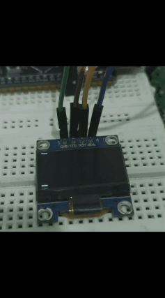

[](https://opensource.org/licenses/MIT)
[](https://www.st.com/en/microcontrollers-microprocessors/stm32f411.html)
[](https://en.wikipedia.org/wiki/I%C2%B2C)

A **from-scratch, register-level** I2C1 master for the STM32F411 Black Pill, plus an SSD1306 OLED driver on top of it. No HAL, no CubeMX — every register write is in this repo.

## Project Overview

The point of the project is the **bus driver**, not the display. The OLED is the first client; the driver is written so a second one (an MPU6050) can be added without touching I2C code.

Two rules shape the whole thing:

- **Every wait is bounded.** An infinite loop on a stuck bus is how firmware hangs with no output and no fault — the worst kind of bug.
- **Every failure releases the bus.** A NACK, a timeout, or an abandoned transfer must never leave SCL stretched or `BUSY` set for the next caller.

## What Works Today

| Area | State |
|---|---|
| I2C1 master | START/STOP, 7-bit addressing, ACK/NACK, 100 kHz, polled, 2 ms bounded waits |
| Write path | `i2c_write()` — address NACK and **data-byte** NACK both detected |
| Read path | `i2c_read()` — combined format with **repeated START**, separate ACK timing for 1, 2 and N bytes |
| Bus scanning | `i2c_probe()` over `0x08..0x77`, found addresses printed on UART |
| Bus recovery | 9 SCL clocks + manual STOP, **returns whether SDA was actually released** |
| SSD1306 | 25-command init sequence, full-screen fill, charge pump enabled |
| Clock | HSI 16 MHz → PLL → **100 MHz** SYSCLK (APB1 50 MHz, APB2 100 MHz) |
| Timebase | DWT cycle counter, 1 µs ticks, `delay_us()` |
| UART2 | 115200 8N1, polled transmit (logging only) |
| API docs | Doxygen, 39 pages, 0 warnings |
| Not there yet | interrupts, DMA, HSE clock source |

<p align="center">
  
</p>
<p align="center"><em>Baremetal I2C Driver → STM32F411 → SSD1306 OLED (Auto-Looping)</em></p>

## Features

**I2C1 Master — `src/i2c.c`**
- Manual register configuration: `CR1`, `CR2`, `CCR`, `TRISE` (no HAL)
- START/STOP generation, 7-bit address shifting, ACK/NACK handling
- 100 kHz standard mode: `CCR = PCLK1 / (2 × 100 kHz) = 250`, `TRISE = 51`
- Every status wait (`BUSY`, `SB`, `ADDR`, `TXE`, `BTF`, `RXNE`, `AF`) has a 2 ms timeout
- Failure paths issue STOP so a NACK or timeout cannot leave the bus claimed
- `ACK` is re-enabled on every exit path, timeouts included

**I2C1 Read Path — `i2c_read()`**
- Combined-format transfer: `START → ADDR+W → REG → Sr → ADDR+R → DATA → STOP`
- Repeated START keeps the bus claimed between "here is the register" and "give me its contents"
- Three ACK regimes, because the master must decide whether to acknowledge *before* the byte arrives:

| Length | Technique |
|---|---|
| `len == 1` | clear ACK, clear ADDR, arm STOP, then read `DR` |
| `len == 2` | set `POS`, clear ADDR, clear ACK, wait `BTF`, STOP, read `DR` twice |
| `len >= 3` | ACK every byte, clear ACK when two bytes remain, NACK the last |

**Bus Recovery — `i2c_bus_recover()`**
- Takes the pins away from the peripheral: `PE = 0`, then `MODER = 0b01` (GPIO output, open-drain)
- Releases both lines *before* the mode change so the switch cannot glitch them low
- Pulses SCL nine times — one byte plus the acknowledge slot a stuck slave is waiting for
- Manual STOP ordered `SCL low → SDA low → SCL high → SDA high`, so neither SDA edge can be mistaken for a START
- Samples `GPIOB_IDR` and **returns 1 only if SDA actually came back high**

**SSD1306 Driver — `src/ssd1306.c`**
- 25-byte init sequence, display kept off until every parameter is set
- Charge pump enable (`0x8D 0x14`) — without it a 3.3 V module stays black
- Horizontal addressing mode, page window opened per page before each burst
- `OLED_Fill()` blasts 8 pages × 129 bytes (control byte + 128 pixels)

**Support layers**
- `clock.c` — PLL bring-up: PLLM 16, PLLN 200, PLLP 2, PLLQ 4, 3 flash wait states
- `timebase.c` — DWT `CYCCNT`; `cycles / 100` = microseconds at 100 MHz
- `uart.c` — USART2 on PA2/PA3, `BRR = PCLK1 / baud`, AF7

**Test bench — `docs/`**
- `docs/MPU6050_ESP32/` — bit-banged ESP32 I2C **target** emulating an MPU-6050 at `0x68`, with the STM32's UART forwarded over USB. `Wire`'s slave mode mishandles repeated START, which `i2c_read()` depends on, so the target is bit-banged.
- `docs/UART_RX_ESP32/` — minimal ESP32 UART bridge: USART2 in on GPIO16, echoed to USB serial

**Reference demo — `examples/oled_demo/`**
- The original single-file version of this project, kept for comparison
- **Is** a 1 KB framebuffer with `SSD1306_DrawPixel()`, `SSD1306_Refresh()` and a single 1024-byte burst
- Draws the border and the two diagonals seen in the GIF above
- Runs standalone at the 16 MHz reset clock (it does not call `clock_init_100Mhz()`)

## Technical Specifications

| Component           | Specification                        |
|---------------------|--------------------------------------|
| **MCU**             | STM32F411CEU6 (ARM Cortex-M4F)       |
| **SYSCLK**          | 100 MHz (PLL from 16 MHz HSI)        |
| **APB1 / APB2**     | 50 MHz / 100 MHz                     |
| **Flash wait**      | 3 WS, prefetch + I/D cache on        |
| **I2C Speed**       | 100 kHz (Standard Mode)              |
| **Display**         | SSD1306 0.96" OLED (128×64), 0x3C    |
| **Protocol**        | I2C, 7-bit addressing                |
| **Transfer**        | Polled, blocking, 2 ms timeout/poll  |
| **Full-screen fill**| ≈ 99 ms — 1104 bytes × 9 bits / 100 kHz |
| **Footprint**       | `text 3008` · `data 0` · `bss 4096`  |

The fill figure is arithmetic, not a scope measurement: 8 pages × (8 bytes window command + 130 bytes pixel data), 9 bits per byte including ACK.

## Hardware Setup

### Pin Configuration

| STM32 Pin | Function | Connects to |
|-----------|----------|-------------|
| **PB6**   | I2C1_SCL (AF4) | OLED SCL / MPU6050 SCL |
| **PB7**   | I2C1_SDA (AF4) | OLED SDA / MPU6050 SDA |
| **PA2**   | USART2_TX (AF7) | USB-serial RX |
| **PA3**   | USART2_RX (AF7) | USB-serial TX (not used yet) |
| **PA13**  | SWDIO | ST-Link SWDIO |
| **PA14**  | SWCLK | ST-Link SWCLK |
| **3.3V**  | Power | OLED VCC |
| **GND**   | Ground | OLED GND |

```
Black Pill                SSD1306 OLED
----------                ------------
PB6  ──────────────────── SCL
PB7  ──────────────────── SDA
3.3V ──────────────────── VCC
GND  ──────────────────── GND
```

**Pull-ups are required.** The internal pull-ups are enabled as a placeholder (~30–50 kΩ), but with a few hundred pF of bus capacitance they cannot meet the 1000 ns rise time that standard mode allows. Fit external 4.7 kΩ from SCL and SDA to 3.3 V.

## Module Map

| File | Responsibility |
|---|---|
| `include/blackpill_stm32f411.h` | Register addresses, bit masks, `GPIO_TypeDef` |
| `src/clock.c` | HSI → PLL → 100 MHz, flash latency, bus prescalers |
| `src/timebase.c` | DWT cycle counter, `timebase_us()`, `delay_us()` |
| `src/uart.c` | USART2 init and polled transmit |
| `src/i2c.c` | I2C1 master: init, probe, write, read, bus recovery |
| `src/ssd1306.c` | Panel init sequence and full-screen fill |
| `src/main.c` | Boot order, bus scan, recovery retry, OLED demo loop |
| `startup_stm32f411.s` | Vector table (102 words) and `Reset_Handler` |
| `stm32f411.ld` | Flash 512 K @ `0x08000000`, RAM 128 K @ `0x20000000` |
| `tools/openocd.cfg` | ST-Link DAP attach, `adapter speed 100` |
| `Doxyfile` | API documentation configuration |

## Build, Flash and Docs

Requires `arm-none-eabi-gcc`, `make`, `openocd` and an ST-Link. `doxygen` and `graphviz` only for the API docs.

```sh
make            # build app.elf and print the size summary
make size       # section sizes only
make hex        # Intel HEX
make bin        # raw binary
make symbols    # symbol table
make disasm     # objdump -d -S
make flash      # program and verify over SWD
make server     # hold an OpenOCD GDB server on :3333
make debug      # arm-none-eabi-gdb attached to that server
make clean
```

Toolchain flags: `-mcpu=cortex-m4 -mthumb -mfpu=fpv4-sp-d16 -mfloat-abi=hard -nostartfiles --specs=nano.specs --specs=nosys.specs`.

Boot order in `main()`: `clock_init_100Mhz()` → `timebase_init()` → LED → `uart2_init()` → `i2c_init()` → scan → recovery-if-needed → rescan → `SSD1306_Init()` → loop.

**API documentation:**

```sh
doxygen Doxyfile          # generates docs/api/html/index.html
```

## Driver API

```c
void    i2c_init(void);                                        /* PB6/PB7, 100 kHz */
uint8_t i2c_probe(uint8_t addr);                               /* 1 = ACK, 0 = NACK/timeout */

uint8_t i2c_write(uint8_t addr, uint8_t *data, uint32_t len);  /* 1 = sent, 0 = NACK/timeout */
uint8_t i2c_read(uint8_t addr, uint8_t reg,
                 uint8_t *data, uint32_t len);                 /* 1 = read, 0 = NACK/timeout */

uint8_t i2c_bus_recover(void);                                 /* 1 = SDA released, 0 = still held */

void    SSD1306_Init(void);                                    /* 25-command sequence */
void    OLED_Fill(uint8_t color);                              /* 0xFF = on, 0x00 = off */
```

A NACK is an answer, not a fault: it means no device owns that address. A **timeout** is the suspicious one — it means SCL or SDA stayed stuck, usually a missing pull-up or a device holding SDA low.

## Transaction Flows

**Write** — `i2c_write()`

```
wait BUSY clear → START → wait SB → ADDR+W → wait ADDR/AF
                → per byte: wait (TXE or AF) → DR = byte
                → wait (BTF or AF) → STOP
```

**Read** — `i2c_read()`

```
wait BUSY clear → START → wait SB → ADDR+W → wait ADDR
                → DR = reg → wait (BTF or AF)
                → repeated START → ADDR+R → wait ADDR
                → ACK regime by length → STOP
```

**Recovery** — `i2c_bus_recover()`

```
PE = 0 → release SDA+SCL → MODER = 0b01 → 9 × SCL pulse → manual STOP
       → sample IDR → i2c_init() → return SDA state
```

## Field Notes: Failure Modes and Setbacks

Things that actually went wrong, what the symptom looked like, and what it taught. Recorded because the symptom is usually indistinguishable from a different fault.

### SDA tied to GND — recovery cannot help, and the log lies

**Test:** SDA wire shorted directly to GND, first hot-plugged mid-run, then held low from boot.

**Observed from boot with SDA low:**

```
--- BareMetal I2C Driver Initialized ---
Scanning I2C Bus...
No devices found. Attempting bus recovery...
Recovery failed: SDA is still held low.
Warning: nothing answered on the bus.
Initializing OLED...
LED ON / Screen WHITE
LED OFF / Screen BLACK          <- repeats every ~2.3 s, screen stays dark
```

**Reading it correctly:**

- `Recovery failed: SDA is still held low` is the **right answer**, not a bug. A slave holding SDA low is waiting for clock edges and lets go after the acknowledge slot. A wire shorted to GND is not waiting for anything — nine clocks, ninety clocks, it stays low. The test is harsher than the function's contract.
- The scan and the recovery both work: the failure was detected, reported, and the rescan ran.
- **`LED ON / Screen WHITE` is the actual defect.** `OLED_Fill()` returns `void`, `SSD1306_Cmd()` returns `void`, and every `i2c_write()` result is discarded. `main()` prints the message unconditionally, so the log reports *intent*, not *outcome*. The panel is dark and the UART says otherwise.
- Hot-plugging SDA to GND produces **no** recovery attempt at all, because recovery runs only once, immediately after the boot scan. Nothing in the demo loop samples the bus.

**Why it does not hang or stall:** RM0383 §18.6.7 defines `SR2.BUSY` as *"Set by hardware on detection of SDA or SCL low … cleared on detection of a Stop condition. This information is still updated when the interface is disabled (PE=0)."* With SDA tied low, `BUSY` is permanent and no STOP can clear it, so every call burns the full 2 ms timeout and returns 0:

| phase | cost |
|---|---|
| scan, 112 addresses × 2 ms | ≈ 224 ms |
| one `OLED_Fill`, 8 pages × 2 writes × 2 ms | ≈ 32 ms |
| `delay_us(2000000)` | 2000 ms |

≈ 2.26 s per loop — hence steady messages every ~2.3 s with a dark screen.

**Status:** diagnosed, not fixed. The remedy is to propagate status: `SSD1306_Cmd` / `SSD1306_Init` / `OLED_Fill` return `uint8_t`, and `main()` prints the truth on failure and retries recovery once.

### HSI makes every delay 3.7 % too long

A `delay_us(2000000)` loop measured **2075 ms** on the receiving side, consistently, across seven samples. That is not measurement error — it is the HSI RC oscillator, specified at ±1 % at 25 °C after factory trim and up to ±4 % over temperature. Every timing constant in this project is derived from it.

**Consequence:** UART stayed inside its ~5 % frame budget by luck, not margin. At 400 kHz I2C the clock becomes a suspect in every future timing bug.

**Fix (pending):** move the PLL input to the onboard 25 MHz crystal — `HSE 25 MHz / PLLM 25 = 1 MHz VCO in`, `× PLLN 200 = 200 MHz`, `/ PLLP 2 = 100 MHz SYSCLK`. Identical tree, crystal-accurate source.

### A halted core looks exactly like broken firmware

During UART bring-up nothing was transmitted. The receiver was fine, the registers were fine, the wiring was fine. `DWT_CYCCNT` was frozen across three reads — the core was **halted**, left over from a debug session. A halted CPU transmits nothing. It also freezes `DWT_CYCCNT`, which is how you tell "debugger holding it" from "firmware wedged": a crash into `Default_Handler` still advances the cycle counter, because `b .` is still executing.

**Lesson:** when nothing comes out, prove the *sender* before suspecting the wire.

### The test equipment was the bug

The ESP32 bridge received nothing while every STM32 register read correct. Root cause was one line in the Arduino sketch:

```c
Serial2.begin(115200, SERIAL_8N1, 16, 17);
pinMode(16, INPUT_PULLUP);      // detaches GPIO16 from UART2
```

On Arduino-ESP32 3.x the peripheral manager treats `pinMode()` on a bus-owned pin as a bus change and runs the UART's deinit, unregistering the RX pin. `Serial2.available()` then returns 0 forever. Harmless on core 2.x, fatal on 3.x.

### Macro name said SR1, register was SR2

`I2C1_SR1_BUSY` was read from `I2C1_SR2`. The value was right, so the code worked — which is exactly what makes this class of bug survive. Renamed to `I2C_SR2_BUSY`.

### MODER mask reused as the field value

Bus recovery originally wrote `0x3U << shift` for both the mask and the value. `0b11` is **analog** mode, not output, so the output driver was disconnected and `BSRR` writes never reached the pad — a recovery routine that silently did nothing. The mask is `0x3U`, the value is `0x1U`. Verified afterwards by reading `MODER` (`0xA280` → `0x5280` → `0xA280`).

## Verification Without a Logic Analyser

No scope was available, so the pin behaviour was verified by instrumenting a scratch build to sample `GPIOB_IDR` **after** each delay (sampling immediately after a register write reads the transition, not the settled level), then reading the trace out of RAM over SWD.

23 samples covering one recovery run:

| point | value | meaning |
|---|---|---|
| after mode switch | `0xC0` | SDA and SCL both released |
| 18 alternating | `0x80` / `0xC0` | 9 SCL rises |
| STOP | `0x80 → 0x00 → 0x40 → 0xC0` | SCL low, SDA low, SCL high, SDA high |

`0x40` appearing only at the third STOP step proves SDA rises while SCL is high (a real STOP) and never falls while SCL is high (no spurious START). Final `IDR = 0xD0`, scan afterwards found a device — the bus was left working.

## Framebuffer Memory Mapping (128×64 OLED)

The SSD1306 organises its 1024-byte GDDRAM into **8 horizontal pages** of 128 bytes. Each byte is one column of 8 vertical pixels.

| Page | Byte Range | Pixel Rows Covered |
| :---: | :--- | :--- |
| **Page 0** | Bytes 0 - 127 | Rows 0 - 7 |
| **Page 1** | Bytes 128 - 255 | Rows 8 - 15 |
| **Page 2** | Bytes 256 - 383 | Rows 16 - 23 |
| **Page 3** | Bytes 384 - 511 | Rows 24 - 31 |
| **Page 4** | Bytes 512 - 639 | Rows 32 - 39 |
| **Page 5** | Bytes 640 - 767 | Rows 40 - 47 |
| **Page 6** | Bytes 768 - 895 | Rows 48 - 55 |
| **Page 7** | Bytes 896 - 1023 | Rows 56 - 63 |

### Pixel Mapping Formula

To plot a pixel at Cartesian `(x, y)`, compute the byte index and the bit inside that byte:

```c
uint16_t index = x + ((y / 8) * 128);
uint8_t  bit   = y % 8;

buffer[index] |= (1 << bit);    /* set pixel */
buffer[index] &= ~(1 << bit);   /* clear pixel */
```

**Concrete example — pixel (50, 20):** page `20 / 8 = 2`, bit `20 % 8 = 4`, index `50 + 2 × 128 = 306` → `buffer[306]`, bit 4.

This formula is what `SSD1306_DrawPixel()` in `examples/oled_demo/main.c` implements.

## SSD1306 Controller Commands

Hex commands are sent over I2C prefixed with control byte `0x00` (command mode); pixel data uses `0x40`.

| Command | Hex Code | Description |
| :--- | :---: | :--- |
| **Display OFF** | `0xAE` | Turns off the OLED display panel. |
| **Display ON** | `0xAF` | Turns on the OLED display panel. |
| **Charge Pump** | `0x8D` | Enables the internal DC-DC charge pump (**critical** — without it a 3.3 V module stays black). |
| **Memory Mode** | `0x20` | Sets the addressing mode (horizontal, vertical or page). |
| **Column Addr** | `0x21` | Sets the start and end column address range for GDDRAM writes. |
| **Page Addr** | `0x22` | Sets the start and end page address range for GDDRAM writes. |

## Common Pitfalls

*  **Forgetting to clear the `ADDR` flag** → permanent **bus lockup** (SCL held low indefinitely). *Fix: read `SR1` then `SR2` in sequence.*
*  **Using push-pull instead of open-drain** → **bus contention** and possible pin damage. *Fix: alternate function, open-drain.*
*  **Missing pull-up resistors** → **floating lines**, intermittent failures. *Fix: external 4.7 kΩ to 3.3 V.*
*  **Not waiting for `TXE`** → **data corruption**, overwritten bytes. *Fix: poll `SR1 & TXE` before writing `DR`.*
*  **Stopping on `TXE` instead of `BTF`** → the last byte is cut mid-frame. *Fix: wait for `BTF`, then raise STOP.*
*  **Leaving `ACK` disabled after a timeout** → the next read NACKs its first byte and still returns success. *Fix: re-enable `ACK` on every exit path.*
*  **Waiting only on `TXE` in a write loop** → a data-byte NACK is only discovered 2 ms later at the closing `BTF` timeout. *Fix: poll `AF` in the same loop.*
*  **Wrong GDDRAM mapping** → garbage or shifted graphics. *Fix: `page = y/8`, `bit = y%8`.*
*  **Trusting the reset clock** → `delay_us()` and `i2c_init()` both assume 100 MHz SYSCLK and PCLK1 = 50 MHz. Skip `clock_init_100Mhz()` and every timing constant is 6.25× off.

## Project Structure

```
BareMetal_I2C_Driver/
├── src/
│   ├── main.c                 # boot order, bus scan, recovery, OLED loop
│   ├── clock.c                # PLL to 100 MHz
│   ├── timebase.c             # DWT microsecond timebase
│   ├── uart.c                 # USART2 polled TX
│   ├── i2c.c                  # I2C1 master (probe, write, read, recovery)
│   └── ssd1306.c              # panel init + full-screen fill
├── include/
│   ├── blackpill_stm32f411.h  # register map and bit masks
│   ├── clock.h  timebase.h  uart.h  i2c.h  ssd1306.h
├── examples/
│   └── oled_demo/main.c       # original single-file framebuffer demo
├── docs/
│   ├── api/                   # generated Doxygen HTML
│   ├── MPU6050_ESP32/         # ESP32 I2C target emulating an MPU-6050
│   ├── UART_RX_ESP32/         # ESP32 UART bridge
│   ├── images/                # demo media
│   └── reference/             # RM0383 notes, study material
├── tools/openocd.cfg          # ST-Link attach recipe
├── Doxyfile                   # API docs configuration
├── startup_stm32f411.s        # vector table + Reset_Handler
├── stm32f411.ld               # memory layout
├── Makefile
└── README.md
```

## Roadmap

- [x] Clock tree, DWT timebase, UART logging
- [x] I2C write path with bounded waits
- [x] SSD1306 init and fill
- [x] I2C read path — repeated START, `RXNE`/`BTF`, `POS` for 2-byte reads
- [x] Bus recovery — 9 SCL pulses, manual STOP, verified by register trace
- [x] Failure reporting — NACK detection per byte, `ACK` restored on all paths
- [ ] Propagate `OLED_Fill()` / `SSD1306_Init()` status to `main()`
- [ ] HSE 25 MHz crystal as PLL source
- [ ] MPU6050 driver on the same `i2c_master` layer
- [ ] Interrupt-driven transfers, then DMA

## Known Limitations

- **HSI clock source.** ±3.7 % measured. Fix before raising the bus to 400 kHz.
- **Silent write failures.** `OLED_Fill()` and `SSD1306_Init()` return `void`, so a failed panel write is invisible except as a dark screen.
- **No runtime bus monitoring.** Recovery is attempted once after the boot scan; nothing checks the bus afterwards.
- **Recovery cannot fix a short.** Nine clocks free a slave that is waiting for them; they cannot lift a wire tied to GND.
- **`clock_init_100Mhz()` has no timeouts** on `PLLRDY` or `SWS`, and no settle delay after the VOS change (RM0383 §5.1.4).
- **`TRISE` is a 6-bit field.** `PCLK1 / 1 MHz + 1` overflows above ~62 MHz APB1. Not reachable at 50 MHz.
- **`PLLM = 16`** puts the VCO input at exactly 1 MHz, the bottom edge of the allowed range.
- **`examples/oled_demo/main.c`** is not in the Makefile and does not compile; it is reference material only.
- **Generated docs and `.gitignore`.** `.gitignore` ignores `*.html`, so `git add docs/api` would stage the JS/PNG/MD5 files and skip the HTML. Either ignore `docs/api/` wholesale or stop ignoring `*.html`.

## Resources

- [STM32F411 Reference Manual (RM0383)](https://www.st.com/resource/en/reference_manual/rm0383-stm32f411xc-e-advanced-armbased-32bit-mcus-stmicroelectronics.pdf)
- [SSD1306 Datasheet](https://cdn-shop.adafruit.com/datasheets/SSD1306.pdf)
- [UM10204 — I2C-bus specification and user manual](https://www.nxp.com/docs/en/user-guide/UM10204.pdf)
- [PM0214 — Cortex-M4 programming manual](https://www.st.com/resource/en/programming_manual/pm0214-stm32-cortexm4-mcus-and-mpus-programming-manual-stmicroelectronics.pdf)

## 👨‍ Author

**Asif Ahamed S**

Final Year - Electronics & Communication Engineering

Rajalakshmi Engineering College, Chennai

🔗 LinkedIn: [asif-ahamed-s-ece](https://linkedin.com/in/asif-ahamed-s-ece)

📧 Email: asifahamed670@gmail.com
