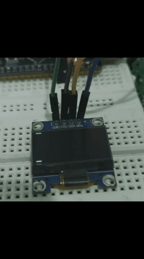

[](https://opensource.org/licenses/MIT)
[](https://www.st.com/en/microcontrollers-microprocessors/stm32f411.html)
[](https://en.wikipedia.org/wiki/I%C2%B2C)

A **from-scratch, register-level** I2C1 master for the STM32F411 Black Pill, plus an SSD1306 OLED driver on top of it. No HAL, no CubeMX — every register write is in this repo.

## Project Overview

The point of the project is the **bus driver**, not the display. The OLED is the first client; the driver is written so a second one (an MPU6050) can be added without touching I2C code.

Every wait in the driver is bounded. An infinite loop on a stuck bus is how firmware hangs with no output and no fault — the worst kind of bug.

## What works today

| Area | State |
|---|---|
| I2C1 master | START/STOP, 7-bit addressing, ACK/NACK, 100 kHz, polling — **write path only** |
| Bus scanning | `i2c_probe()` over `0x08..0x77`, found addresses printed on UART |
| SSD1306 | 25-command init sequence, full-screen fill, charge pump enabled |
| Clock | HSI 16 MHz → PLL → **100 MHz** SYSCLK (APB1 50 MHz, APB2 100 MHz) |
| Timebase | DWT cycle counter, 1 µs ticks, `delay_us()` |
| UART2 | 115200 8N1, polled transmit (logging only) |
| Not there yet | read path, repeated START, bus recovery, interrupts, DMA |

<p align="center">
  
</p>
<p align="center"><em>Baremetal I2C Driver → STM32F411 → SSD1306 OLED (Auto-Looping)</em></p>

## Features

**I2C1 Master — `src/i2c.c`**
- Manual register configuration: `CR1`, `CR2`, `CCR`, `TRISE` (no HAL)
- START/STOP generation, 7-bit address shifting, ACK/NACK handling
- 100 kHz standard mode: `CCR = PCLK1 / (2 × 100 kHz) = 250`, `TRISE = 51`
- Every status wait (`BUSY`, `SB`, `ADDR`, `TXE`, `BTF`) has a 2 ms timeout
- Failure paths issue STOP so a NACK or timeout cannot leave the bus claimed

**SSD1306 Driver — `src/ssd1306.c`**
- 25-byte init sequence, display kept off until every parameter is set
- Charge pump enable (`0x8D 0x14`) — without it a 3.3 V module stays black
- Horizontal addressing mode, page window opened per page before each burst
- `OLED_Fill()` blasts 8 pages × 129 bytes (control byte + 128 pixels)

**Support layers**
- `clock.c` — PLL bring-up: PLLM 16, PLLN 200, PLLP 2, PLLQ 4, 3 flash wait states
- `timebase.c` — DWT `CYCCNT`; `cycles / 100` = microseconds at 100 MHz
- `uart.c` — USART2 on PA2/PA3, `BRR = PCLK1 / baud`, AF7

**Reference demo — `examples/oled_demo/`**
- The original single-file version of this project, kept for comparison
- **Is** a 1 KB framebuffer with `SSD1306_DrawPixel()`, `SSD1306_Refresh()` and a single 1024-byte burst
- Draws the border and the two diagonals seen in the GIF above
- Runs standalone at the 16 MHz reset clock (it does not call `clock_init_100Mhz()`)

## Technical Specifications

| Component           | Specification                        |
|---------------------|--------------------------------------|
| **MCU**             | STM32F411CEU6 (ARM Cortex-M4F)       |
| **SYSCLK**          | 100 MHz (PLL from 16 MHz HSI)        |
| **APB1 / APB2**     | 50 MHz / 100 MHz                     |
| **Flash wait**      | 3 WS, prefetch + I/D cache on        |
| **I2C Speed**       | 100 kHz (Standard Mode)              |
| **Display**         | SSD1306 0.96" OLED (128×64), 0x3C    |
| **Protocol**        | I2C, 7-bit addressing                |
| **Transfer**        | Polled, blocking, 2 ms timeout/poll  |
| **Full-screen fill**| ≈ 99 ms — 1096 bytes × 9 bits / 100 kHz |
| **Footprint**       | `text 2500` · `data 0` · `bss 4096`  |

The fill figure is arithmetic, not a scope measurement: 8 pages × (1 address + 7 command + 129 data) bytes, 9 bits per byte including ACK.

## Hardware Setup

### Pin Configuration

| STM32 Pin | Function | Connects to |
|-----------|----------|-------------|
| **PB6**   | I2C1_SCL (AF4) | OLED SCL |
| **PB7**   | I2C1_SDA (AF4) | OLED SDA |
| **PA2**   | USART2_TX (AF7) | USB-serial RX |
| **PA3**   | USART2_RX (AF7) | USB-serial TX (not used yet) |
| **PA13**  | SWDIO | ST-Link SWDIO |
| **PA14**  | SWCLK | ST-Link SWCLK |
| **3.3V**  | Power | OLED VCC |
| **GND**   | Ground | OLED GND |

```
Black Pill                SSD1306 OLED
----------                ------------
PB6  ──────────────────── SCL
PB7  ──────────────────── SDA
3.3V ──────────────────── VCC
GND  ──────────────────── GND
```

**Pull-ups are required.** The internal pull-ups are enabled as a placeholder (~30–50 kΩ), but with a few hundred pF of bus capacitance they cannot meet the 1000 ns rise time that standard mode allows. Fit external 4.7 kΩ from SCL and SDA to 3.3 V.

## Module Map

| File | Responsibility |
|---|---|
| `include/blackpill_stm32f411.h` | Register addresses, bit masks, `GPIO_TypeDef` |
| `src/clock.c` | HSI → PLL → 100 MHz, flash latency, bus prescalers |
| `src/timebase.c` | DWT cycle counter, `timebase_us()`, `delay_us()` |
| `src/uart.c` | USART2 init and polled transmit |
| `src/i2c.c` | I2C1 master: `i2c_init`, `i2c_probe`, `i2c_write` |
| `src/ssd1306.c` | Panel init sequence and full-screen fill |
| `src/main.c` | Boot order, bus scan, OLED demo loop |
| `startup_stm32f411.s` | Vector table (102 words) and `Reset_Handler` |
| `stm32f411.ld` | Flash 512 K @ `0x08000000`, RAM 128 K @ `0x20000000` |
| `tools/openocd.cfg` | ST-Link DAP attach, `adapter speed 100` |

## Build and Flash

Requires `arm-none-eabi-gcc`, `make`, `openocd` and an ST-Link.

```sh
make            # build app.elf and print the size summary
make size       # section sizes only
make flash      # program and verify over SWD
make server     # hold an OpenOCD GDB server on :3333
make debug      # arm-none-eabi-gdb attached to that server
make disasm     # objdump -d -S
make clean
```

Toolchain flags: `-mcpu=cortex-m4 -mthumb -mfpu=fpv4-sp-d16 -mfloat-abi=hard -nostartfiles --specs=nano.specs --specs=nosys.specs`.

Boot order in `main()`: `clock_init_100Mhz()` → `timebase_init()` → LED → `uart2_init()` → `i2c_init()` → scan → `SSD1306_Init()` → loop.

## Driver API

```c
void    i2c_init(void);                                              /* PB6/PB7, 100 kHz */
uint8_t i2c_probe(uint8_t addr);                                     /* 1 = ACK, 0 = NACK/timeout */
uint8_t i2c_write(uint8_t addr, uint8_t *data, uint8_t len);         /* 1 = sent, 0 = NACK/timeout */

void    SSD1306_Init(void);                                          /* 25-command sequence */
void    OLED_Fill(uint8_t color);                                    /* 0xFF = on, 0x00 = off */
```

A NACK is an answer, not a fault: it means no device owns that address. A **timeout** is the suspicious one — it means SCL or SDA stayed stuck, usually a missing pull-up or a device holding SDA low.

## Framebuffer Memory Mapping (128×64 OLED)

The SSD1306 organises its 1024-byte GDDRAM into **8 horizontal pages** of 128 bytes. Each byte is one column of 8 vertical pixels.

| Page | Byte Range | Pixel Rows Covered |
| :---: | :--- | :--- |
| **Page 0** | Bytes 0 - 127 | Rows 0 - 7 |
| **Page 1** | Bytes 128 - 255 | Rows 8 - 15 |
| **Page 2** | Bytes 256 - 383 | Rows 16 - 23 |
| **Page 3** | Bytes 384 - 511 | Rows 24 - 31 |
| **Page 4** | Bytes 512 - 639 | Rows 32 - 39 |
| **Page 5** | Bytes 640 - 767 | Rows 40 - 47 |
| **Page 6** | Bytes 768 - 895 | Rows 48 - 55 |
| **Page 7** | Bytes 896 - 1023 | Rows 56 - 63 |

### Pixel Mapping Formula

To plot a pixel at Cartesian `(x, y)`, compute the byte index and the bit inside that byte:

```c
uint16_t index = x + ((y / 8) * 128);
uint8_t  bit   = y % 8;

buffer[index] |= (1 << bit);    /* set pixel */
buffer[index] &= ~(1 << bit);   /* clear pixel */
```

**Concrete example — pixel (50, 20):** page `20 / 8 = 2`, bit `20 % 8 = 4`, index `50 + 2 × 128 = 306` → `buffer[306]`, bit 4.

This formula is what `SSD1306_DrawPixel()` in `examples/oled_demo/main.c` implements.

## SSD1306 Controller Commands

Hex commands are sent over I2C prefixed with control byte `0x00` (command mode); pixel data uses `0x40`.

| Command | Hex Code | Description |
| :--- | :---: | :--- |
| **Display OFF** | `0xAE` | Turns off the OLED display panel. |
| **Display ON** | `0xAF` | Turns on the OLED display panel. |
| **Charge Pump** | `0x8D` | Enables the internal DC-DC charge pump (**Critical!** Required to generate the high voltage needed to light up the OLED pixels). |
| **Memory Mode** | `0x20` | Sets the memory addressing mode (e.g., Horizontal, Vertical, or Page addressing). |
| **Column Addr** | `0x21` | Sets the start and end column address range for GDDRAM writes. |
| **Page Addr** | `0x22` | Sets the start and end page address range for GDDRAM writes. |

## Common Pitfalls to be Avoided

When writing baremetal I2C drivers, hardware-level mistakes can cause silent failures or permanent bus lockups. Here are the critical issues handled in this implementation:

*  **Forgetting to clear the `ADDR` flag** → Causes permanent **bus lockup** (SCL held low indefinitely). *Fix: Read `SR1` then `SR2` sequentially.*
*  **Using Push-Pull instead of Open-Drain** → Causes **bus contention** and potential hardware damage. *Fix: Configure GPIO pins as Alternate Function Open-Drain.*
*  **Missing pull-up resistors** → Results in **floating bus lines** and failed communication. *Fix: Use external 4.7kΩ pull-ups to VCC.*
*  **Not waiting for the `TXE` flag** → Causes **data corruption** or overwritten bytes. *Fix: Poll `I2C_SR1 & I2C_SR1_TXE` before writing to `I2C_DR`.*
*  **Wrong memory mapping (GDDRAM)** → Results in a **garbage display** or shifted graphics. *Fix: Strictly follow the `Page = y/8`, `Bit = y%8` mapping formula.*
*  **Stopping on `TXE` instead of `BTF`** → Cuts the last byte mid-frame; the final page of a fill looks wrong. *Fix: Wait for `BTF`, then raise STOP.*
*  **Trusting the reset clock** → `delay_us()` and `i2c_init()` both assume 100 MHz SYSCLK and PCLK1 = 50 MHz. Skip `clock_init_100Mhz()` and every timing constant is 6.25× off.

## Project Structure

```
BareMetal_I2C_Driver/
├── src/
│   ├── main.c                 # boot order, bus scan, OLED fill loop
│   ├── clock.c                # PLL to 100 MHz
│   ├── timebase.c             # DWT microsecond timebase
│   ├── uart.c                 # USART2 polled TX
│   ├── i2c.c                  # I2C1 master (probe + write)
│   └── ssd1306.c              # panel init + full-screen fill
├── include/
│   ├── blackpill_stm32f411.h  # register map and bit masks
│   ├── clock.h  timebase.h  uart.h  i2c.h  ssd1306.h
├── examples/
│   └── oled_demo/main.c       # original single-file framebuffer demo
├── tools/openocd.cfg          # ST-Link attach recipe
├── docs/                      # images, RM0383 notes, study material
├── startup_stm32f411.s        # vector table + Reset_Handler
├── stm32f411.ld               # memory layout
├── Makefile
└── README.md
```

## Roadmap

- [x] Clock tree, DWT timebase, UART logging
- [x] I2C write path with bounded waits
- [x] SSD1306 init and fill
- [ ] I2C read path (repeated START, `RXNE`/`BTF` handling)
- [ ] Bus recovery: 9 SCL pulses + manual STOP when a leaked START wedges `BUSY`
- [ ] MPU6050 driver on the same `i2c_master` layer
- [ ] Interrupt-driven transfers, then DMA

## Resources

- [STM32F411 Reference Manual (RM0383)](https://www.st.com/resource/en/reference_manual/rm0383-stm32f411xc-e-advanced-armbased-32bit-mcus-stmicroelectronics.pdf)
- [SSD1306 Datasheet](https://cdn-shop.adafruit.com/datasheets/SSD1306.pdf)
- [UM10204 — I2C-bus specification and user manual](https://www.nxp.com/docs/en/user-guide/UM10204.pdf)
- [PM0214 — Cortex-M4 programming manual](https://www.st.com/resource/en/programming_manual/pm0214-stm32-cortexm4-mcus-and-mpus-programming-manual-stmicroelectronics.pdf)

## 👨‍ Author

**Asif Ahamed S**

Final Year - Electronics & Communication Engineering

Rajalakshmi Engineering College, Chennai

🔗 LinkedIn: [linkedin.com/in/asif-ahamed-s-ece](asif-ahamed-s-ece)

📧 Email: asifahamed670@gmail.com
